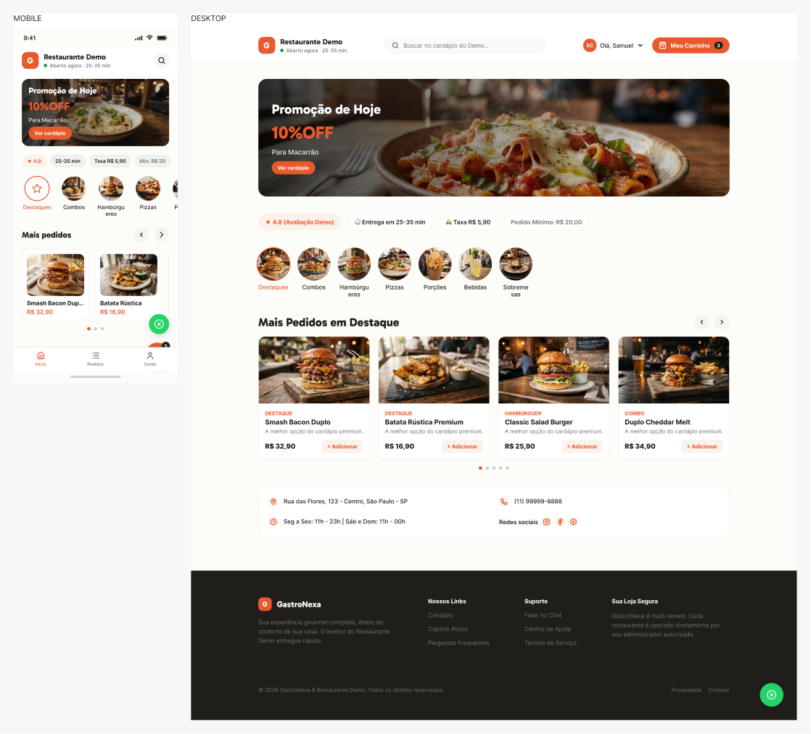

# Samuel Gomes

### Desenvolvedor Full Stack | TypeScript · Node.js · React

Construo aplicações web e produtos SaaS de ponta a ponta, do desenho da solução ao backend, banco de dados, interface, testes e implantação.

**Fortaleza, CE · Aberto a oportunidades remotas no Brasil**

## Projetos em destaque

### 1. [GastroNexa — SaaS multi-restaurante](https://github.com/samuelggds/Projeto-Restaurants)

**Desafio:** integrar cardápio, pedidos, atendimento, pagamentos e diferentes perfis de usuários em uma mesma plataforma, com dados separados por restaurante.

**Minha atuação:** projeto independente em que conduzo as decisões de produto e implementação, do frontend às regras de negócio e infraestrutura.

- **Engenharia:** Node.js, Express, TypeScript, PostgreSQL, Prisma e arquitetura multi-tenant.
- **Integrações:** Pix/cartão via Mercado Pago, webhooks e atualizações com Socket.IO.
- **Qualidade:** Docker, CI/CD com GitHub Actions e testes automatizados.

[Site oficial](https://www.gastronexa.com.br/) · [Repositório](https://github.com/samuelggds/Projeto-Restaurants) · [Estudo de caso](portfolio/gastronexa.md) · [Arquitetura](https://github.com/samuelggds/Projeto-Restaurants/blob/main/ARCHITECTURE.md)

*Prévia visual de telas do Figma; não é uma captura de produção.*

### 2. [MG Orçamentos — aplicação corporativa](https://github.com/samuelggds/Project-Budget)

**Desafio:** concentrar o fluxo de orçamentos, clientes, serviços, documentos e comunicação com clientes em uma ferramenta utilizada no contexto da MG Refrigerações.

**Minha atuação:** desenvolvimento da aplicação em React e TypeScript, integração com Supabase e serviços de e-mail, incluindo segurança de acesso.

- **Fluxo operacional:** criação e acompanhamento de orçamentos, status e geração de PDFs.
- **Segurança:** autenticação, políticas de acesso e verificação adicional por e-mail.
- **Integrações:** recebimento com AWS SES/S3/SQS/Lambda e envio com Resend; aplicação web e estrutura para desktop com Tauri.

[Repositório](https://github.com/samuelggds/Project-Budget) · [Estudo de caso](portfolio/mg-orcamentos.md) · [Site institucional da empresa](https://mgrefrigeracoes.com.br/)

*O site institucional não é uma demonstração pública do painel de orçamentos.*

### 3. [SaaS de Orçamentos — assinaturas e controle de acesso](https://github.com/samuelggds/Projeto-Budget-2)

Projeto independente de orçamentos com clientes, estoque, PDFs e cobrança recorrente por Pix. Inclui perfis de acesso, políticas RLS no Supabase, regras de bloqueio por assinatura e testes automatizados.

**Stack:** React, TypeScript, Supabase, Edge Functions, Mercado Pago, Vitest e Tauri.

[Repositório](https://github.com/samuelggds/Projeto-Budget-2) · [Estudo de caso](portfolio/orcamentos.md)

---

## Stack e prática de engenharia

| Área | Tecnologias e práticas |
| --- | --- |
| Backend | Node.js, TypeScript, Express, APIs REST, JWT, webhooks, Socket.IO |
| Frontend | React, TypeScript, Vite, Styled Components, HTML, CSS |
| Dados e segurança | PostgreSQL, Prisma, Supabase, RBAC, RLS, isolamento multi-tenant |
| Infraestrutura | Docker, AWS, GitHub Actions, CI/CD |
| Qualidade | Testes unitários, integração e E2E conforme o risco; Playwright e Vitest |

Busco resolver problemas de negócio com regras aplicadas no backend, autorização orientada ao usuário autenticado, documentação e testes proporcionais ao risco. Os projetos acima foram desenvolvidos de forma independente e demonstram minha atuação técnica; não são apresentados como vínculos empregatícios anteriores.

## Contato

[LinkedIn](https://www.linkedin.com/in/samuel-gomes08/) · [GitHub](https://github.com/samuelggds) · [E-mail](mailto:accyt2@hotmail.com)
