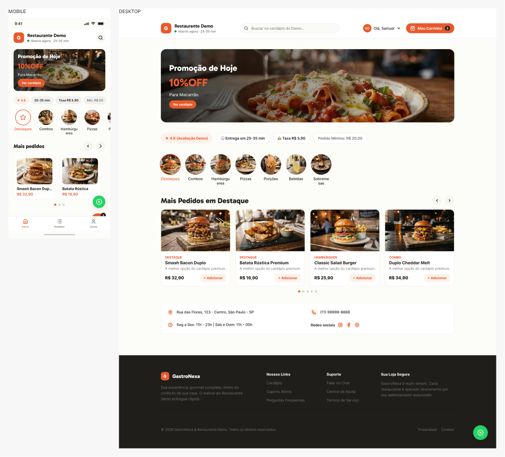

# GastroNexa

**Desenvolvimento Full Stack · Projeto pessoal de Samuel Gomes**

Plataforma SaaS para organizar a operação de restaurantes: cardápio digital, pedidos, mesas, cozinha e delivery. O projeto conecta a experiência do cliente às telas usadas pela equipe do restaurante.

*Prévia de interface exportada do Figma do projeto, com dados demonstrativos.*

## Funcionalidades

- Navegação pelo cardápio, personalização de produtos e carrinho.
- Gestão de pedidos e acompanhamento do preparo.
- Fluxos de atendimento de mesas e delivery.
- Atualizações de status em tempo real.
- Perfis de acesso para clientes e equipes dos restaurantes.
- Integração de pagamentos e assinaturas.

## Minha atuação

Desenvolvimento das interfaces, da API e da integração com o banco de dados. O trabalho inclui autenticação, autorização por perfil, comunicação em tempo real e integração com serviços externos.

## Tecnologias

| Área | Tecnologias |
| --- | --- |
| Front-end | React, TypeScript, Vite e Styled Components |
| Back-end | Node.js, Express e TypeScript |
| Dados | PostgreSQL e Prisma |
| Tempo real | Socket.IO |
| Qualidade | Vitest, Playwright e GitHub Actions |
| Infraestrutura | Docker e AWS |

## Prática de engenharia

O projeto envolve organização de dados por restaurante, permissões conforme a função do usuário e sincronização entre interfaces. Há testes automatizados e fluxos de integração contínua no desenvolvimento.

Esta apresentação reúne apenas uma visão geral do produto e uma prévia visual. O código-fonte, as configurações de implantação e os dados de operação não fazem parte deste material.

[Conversar no LinkedIn](https://www.linkedin.com/in/samuel-gomes-3493a2447/) · [Voltar ao perfil](https://github.com/samuelggds)
