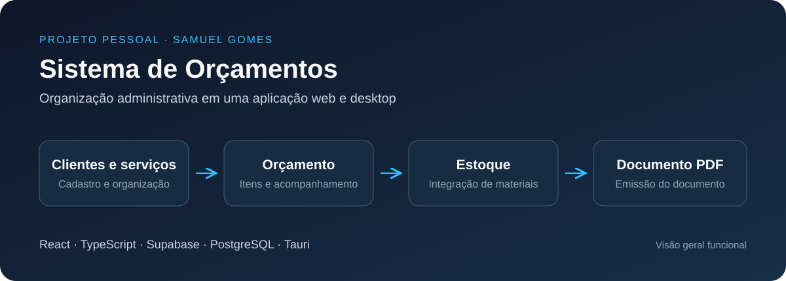

# Sistema de Orçamentos

**Desenvolvimento Full Stack · Projeto pessoal de Samuel Gomes**

Aplicação para organizar clientes, serviços, estoque e orçamentos, com emissão de documentos em PDF. O projeto reúne tarefas administrativas em uma interface web e inclui uma versão desktop.

*Visão geral do fluxo funcional. Esta ilustração não é uma captura da interface.*

## Funcionalidades

- Cadastro e organização de clientes e serviços.
- Criação e acompanhamento de orçamentos.
- Integração entre itens de orçamento e estoque.
- Geração de documentos em PDF.
- Autenticação e permissões por perfil.
- Integração de cobrança Pix e acompanhamento de assinaturas.

## Minha atuação

Desenvolvimento da aplicação com React e TypeScript, integração com o Supabase e implementação de fluxos de orçamento, estoque, documentos e cobrança. O trabalho também inclui controle de acesso no banco e integração com serviços externos.

## Tecnologias

| Área | Tecnologias |
| --- | --- |
| Interface web | React, TypeScript e Vite |
| Dados e autenticação | Supabase e PostgreSQL |
| Funções de back-end | Supabase Edge Functions e Deno |
| Controle de acesso | Políticas RLS e permissões por perfil |
| Integração de pagamentos | Mercado Pago e webhooks |
| Qualidade | Vitest e React Testing Library |
| Aplicação desktop | Tauri |

## Prática de engenharia

O projeto envolve integração entre dados administrativos, permissões no banco e eventos de pagamento. A versão desktop conta com distribuição de instaladores e mecanismo de atualização.

Esta apresentação contém apenas uma visão geral funcional e técnica. O código-fonte, os dados de clientes e as regras comerciais internas não fazem parte deste material.

[Conversar no LinkedIn](https://www.linkedin.com/in/samuel-gomes-3493a2447/) · [Voltar ao perfil](https://github.com/samuelggds)
